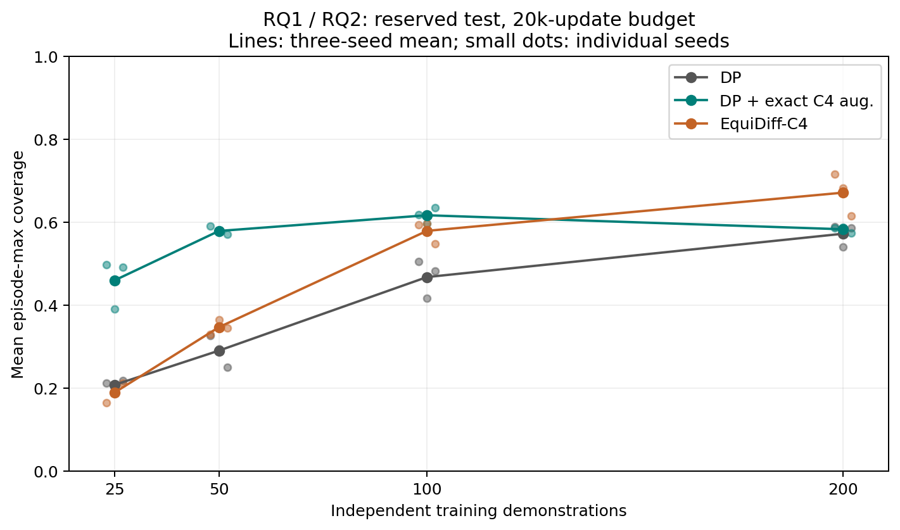
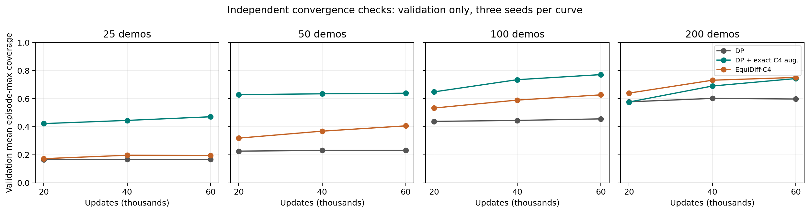
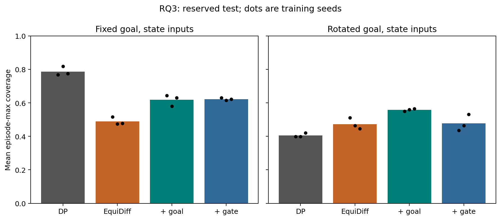

# 等变结构是否优于精确数据增强？Push-T 上的迁移、机制与失效边界

RQ1 / RQ2 / RQ3 主实验报告；结果冻结日期：2026-11-23。

本文对应原 proposal《Does Equivariance Beat Exact Augmentation? Transferring Equivariant Diffusion Policy to Planar Pushing with Controllable Symmetry》。[原文快照](proposal_snapshot.md)、[机器可读汇总](summary.json)、[完整数值表](tables.md)与本报告一起保存。

## 摘要

扩散策略可以从机器人示范中学习动作序列，但示范昂贵，策略是否能够利用任务的几何对称性来减少数据需求，是一个重要问题。Equivariant Diffusion Policy（EquiDiff）将旋转等变性写入网络，在原论文的机器人操作任务中取得了良好结果。然而，跨任务迁移、与物理一致的数据增强的比较，以及错误对称性假设的后果，仍需要分别验证。

本项目把 EquiDiff 的核心结构适配到平面接触推动任务 Push-T，构建具有经过数值验证的 C4 对称性的环境和渲染过程。在统一的更新预算下，我们比较普通 Diffusion Policy（DP）、DP 加精确 C4 增强，以及 EquiDiff-C4；另外通过固定或旋转目标、显式目标输入和可学习对称性破坏门控，研究等变假设的适用条件。

结果显示：第一，在 25/50 条示范时，尚无充分证据支持 EquiDiff 相对 DP 的稳定低数据优势；在 100/200 条示范时，EquiDiff 的主指标分别高出 DP 0.1115/0.0991。第二，精确增强在 25/50 条示范时明显优于 EquiDiff，100 条时差异不确定，200 条时 EquiDiff 在主实验预算内占优，但独立的长训练验证曲线表明这一优势随训练预算增大而明显缩小。第三，在目标不作为状态输入且固定于世界坐标的条件下，普通 EquiDiff 比 DP 低 0.2981；目标输入和门控各恢复约 0.13，但均未恢复到 DP 水平。图像中目标可见时，没有观察到同样的 coverage 大幅下降。

这些发现支持一个有条件的结论：等变性是一种依赖任务对称性、可观测信息、数据量与训练预算的归纳偏置；它不能被视为在任何低数据条件下都优于精确增强的通用保证。以下主结论不依赖尚在运行的可选 E4 实验。

## 1. Background：为什么研究这个问题？

### 1.1 Diffusion Policy 与机器人示范学习

模仿学习让机器人从示范轨迹学习“观察到当前场景后应该执行什么动作”。DP [1] 使用条件扩散模型生成一段动作序列，再滚动执行其中一部分并重新观察。与只输出一个确定动作的回归模型相比，它能够表达复杂、多模态的动作分布，适合接触操作等任务。

困难是机器人示范通常昂贵。若同一种操作只是整体转了一个方向，理想的策略应当能够复用已学到的知识，而不是为每个朝向重新收集大量示范。

### 1.2 等变结构与数据增强是两种不同的解决方案

旋转等变性的含义是：把场景旋转之后，模型输出的动作也按相同规则旋转。对随机策略，更准确的说法是动作分布满足相应变换规律，而不是两次使用独立随机噪声采样的动作必须逐点相同。

对确定的噪声预测函数，可以写为：

$$\epsilon_\theta(g a_t,t,g o)=g\epsilon_\theta(a_t,t,o).$$

其中，$o$ 是观测，$a_t$ 是扩散过程中的带噪动作，$g$ 是旋转变换。EquiDiff [2] 通过等变特征和参数共享，把这个关系嵌入去噪器结构。

数据增强采取另一条路径：同时旋转训练图像、状态和动作标签，让普通网络从这些样本中学习旋转规律。两种方法都使用对称性知识，但“通过架构强制满足”与“通过训练数据学习满足”并不等价。

原 proposal 引用 EquiDiff 在 12 个 MimicGen 任务、100 条示范条件下相对 DP 平均提升 21.9 个成功率百分点，以及 Appendix I 的结构与增强比较。这些数字是研究背景，不是本项目基线，也不能与下面的 Push-T coverage 直接相减。

## 2. Research Gap：我们要补充哪些证据？

### Gap 1：原任务上的数据效率能否跨任务家族成立？

原论文的主要证据来自三维桌面操作。Push-T 是平面、非抓取、接触丰富的推动任务，动作是二维位置，运动与接触模式不同。原任务上的有效性不能直接证明在 Push-T 上、特别是少量示范下，等变结构仍然占优。

本项目的目的不是复现原论文每个数字，而是检验其方法在另一个任务家族中的适用边界。

### Gap 2：结构优势能否与增强质量分开？

在斜视角下，对图像做二维旋转通常不等于对三维场景做物理旋转。如果增强后的图像和动作标签不再对应真实可实现的场景，那么“等变结构优于旋转增强”可能同时反映架构差异和增强质量差异。

这是 proposal 提出的混杂因素与研究动机。本项目通过构造物理与像素变换一致的 C4 测试环境，改善比较条件；它本身不证明原论文所有增强样本都错误，也不推翻原论文的实验结果。

### Gap 3：当任务不符合对称性假设时，会发生什么？

对称性不仅取决于物体和动力学，也取决于目标与策略能观察到的信息。如果目标固定在世界坐标，而模型被要求对不含目标的输入保持旋转等变，这种约束可能与正确动作相冲突。

我们需要量化这种损失，并测试“补充目标信息”和“允许模型学习偏离严格对称性”是否有效。这里的研究缺口是本 proposal 的工作定位，不是对所有已有文献的穷尽性新颖性证明。

## 3. 三个研究问题、目的与原始假设

| 问题 | Proposal 中的问题 | 实验目的 | 预先提出的预测 |
|---|---|---|---|
| RQ1：迁移与数据效率 | EquiDiff 的数据效率优势能否迁移到平面推动？ | 随示范数量变化，比较 EquiDiff 与 DP | H1：在不超过 50 条示范时，EquiDiff 优于 DP |
| RQ2：收益机制 | 有了精确 C4 增强，等变架构是否仍优于 DP + 增强？ | 在增强物理一致的条件下检验结构的额外价值 | H2：相对精确增强的差距会缩小，可能不显著 |
| RQ3：失效与修正 | 错误等变性造成多大损失，目标输入和门控能否恢复？ | 检验对称性假设失效及两种修正 | H3：固定目标且状态不含目标时 EquiDiff < DP；目标输入恢复到至少 DP 水平 |

RQ1 和 RQ2 使用同一批三方法主实验，不能把它们重复计作两批独立训练。H3 中“错误约束有害”和“修正完全恢复”是两项需要分别判断的预测。

## 4. 实验设计与评估口径

### 4.1 Push-T-Rot：使对称性可控

Push-T 的目标是推动 T 形块，使其与目标形状对齐。我们使用 C4 群，即 0、90、180、270 度旋转。正方形边界和像素格点对这些旋转兼容，90 度图像变换可用无插值的 `rot90` 实现。

实际实现以 `(255.5, 255.5)` 为旋转中心。原目标位置 `(256, 256)` 连同角度一起旋转，因此四个目标位置分别是 `(256,256)`、`(256,255)`、`(255,255)`、`(255,256)`。这修正了 proposal 中“目标只改变角度、位置固定”的简化描述。

动力学在各旋转坐标系内原生运行；渲染先把当前状态逆变换到规范场景，再调用原始渲染器并做 `rot90`。规范场景仅用于渲染，不额外推进物理。这种构造提供精确的像素旋转关系，不能说原始 rasterizer 自身天然精确等变。

六条留出示范的动作序列在四个朝向及两种 legacy 初始化模式下完成了回放验证。记录的最大位置误差约 `4.89e-11`、coverage 误差约 `1.20e-12`，对应构造渲染的像素误差为零。EquiDiff 全模型预检的最大数值等变误差约 `2.46e-6`，梯度有限。上述数值是所测样本和配置下的正确性证据，不是所有状态上的数学证明；人类录制图像与重新渲染图像仍存在单独记录的残差。

### 4.2 数据与比较方法

官方数据含 206 条示范，固定划分为 200 条训练、6 条留出验证。主实验使用嵌套的 25/50/100/200 条训练示范，因此没有按照 proposal 的初稿把全部 206 条用于训练。所有方法共享相同的轨迹子集和固定、尽量平衡的基础朝向；25 或 50 不能被 4 整除时不可能每个朝向数量完全相同。

| 方法 | 具体尝试 | 控制条件 |
|---|---|---|
| DP | 普通图像编码器与时间 U-Net | 不额外施加在线旋转增强 |
| DP + exact C4 augmentation | 对图像、agent 位置、物体状态及动作一致地旋转 | 与 DP 架构相同；增加在线精确增强，独立示范数量不增加 |
| EquiDiff-C4 | 适配上游等变编码器、动作表示和群轴共享时间 U-Net | 使用同样基础数据；不是早期 Frame Averaging fallback |

图像主实验为 4 个数据量 × 3 种方法 × 3 个训练 seed，共 36 次训练。每次使用 20,000 次优化更新、batch 64、AdamW、学习率 `1e-4`、U-Net 宽度 `[512,1024,2048]`、EMA、100 步扩散训练/推理，FP32 且禁用 TF32。观测历史长度为 2，动作 horizon 为 16，每次执行 8 步。

这是统一更新预算的适配实验，不是相同 GPU 小时、相同参数量或完整官方训练配方的比较。EquiDiff-C4 约 257.6M 参数，DP 约 288.4M；原版 DP 的长训练参考另行执行，不混入主表。

### 4.3 Coverage、success 与统计单位

定义单步 coverage 为：

$$c_t=\frac{\operatorname{area}(\text{block}_t\cap\text{goal})}{\operatorname{area}(\text{goal})}.$$

它不是 IoU。每个 episode 的分数是整个 rollout 中的最大 coverage，每次测试最多 300 个控制步。success 使用上游的严格阈值 `coverage > 0.95`，不是 proposal 初稿中的 `>= 0.95`。

预留测试包含 25 个基础初始状态，每个配对四个朝向，共 100 episodes。每个训练 seed 在 16k、18k、20k 三个预先保留的 EMA checkpoint 上评估。主指标先对这三个 checkpoint 的 episode-max coverage 求平均，再对测试初态和三个训练 seed 汇总。**它不是最后单个 checkpoint，不是训练全程最高值，也不是最终时刻的 coverage。**

表中的 `±` 是三个训练 seed 之间的样本标准差。差值区间来自 10,000 次配对 bootstrap，同时重采样训练 seed 和基础初始状态，并把同一初态的四个朝向始终保留在一起。三个 checkpoint 是重复测量，不作为三个独立训练 seed。区间未做多重比较校正，且只有三个训练 seed，不能据此作过强的总体结论；区间包含零不等于证明两方法等价。

## 5. RQ1：数据效率能否迁移到 Push-T？

### 5.1 做了什么

固定模型训练预算与评估协议，改变独立示范数量，直接比较 DP 与 EquiDiff-C4。为回答 RQ2，同时训练 DP + 精确增强，结果放在同一张表中。

### 5.2 结果

**表 1：图像、旋转目标条件下的主测试 coverage，均值 ± seed 标准差。**

| 示范数 | DP | DP + 精确 C4 增强 | EquiDiff-C4 |
|---:|---:|---:|---:|
| 25 | 0.2076 ± 0.0126 | **0.4598 ± 0.0604** | 0.1893 ± 0.0236 |
| 50 | 0.2899 ± 0.0385 | **0.5787 ± 0.0104** | 0.3465 ± 0.0173 |
| 100 | 0.4675 ± 0.0460 | **0.6166 ± 0.0194** | 0.5789 ± 0.0277 |
| 200 | 0.5721 ± 0.0276 | 0.5828 ± 0.0074 | **0.6712 ± 0.0518** |

加粗仅表示该行最高均值，不表示与每个其他方法都有可靠差异。



**表 2：EquiDiff-C4 减 DP 的主指标差值。**

| 示范数 | Coverage 差值 | 配对 95% CI | 解释 |
|---:|---:|---|---|
| 25 | -0.0183 | [-0.0597, 0.0262] | 没有支持 EquiDiff 优势的证据 |
| 50 | +0.0565 | [-0.0220, 0.1391] | 均值更高，但不确定性跨零 |
| 100 | +0.1115 | [0.0279, 0.1896] | 本协议下支持 EquiDiff 更高 |
| 200 | +0.0991 | [0.0247, 0.1596] | 本协议下支持 EquiDiff 更高 |

### 5.3 如何回答 RQ1 和 H1？

EquiDiff 可以适配到 Push-T，并在中高示范数量下取得相对 DP 的收益，但本实验没有支持“最少数据时收益最大”或“≤50 条示范时稳定更好”。因此，**H1 未获支持，RQ1 的回答是有条件的迁移成功，而不是无条件的数据效率优势。**

可能的解释包括架构的优化需求、数据分布以及固定预算的作用；本实验没有逐一隔离这些机制，不能把任意一种解释当成已证明原因。特别是，不能用“参数更少”直接推导“必然更省示范”。

## 6. RQ2：有了精确增强，结构还提供多少额外收益？

### 6.1 做了什么

在同一组基础示范上，把在线增强限制为已验证的精确 C4 变换，避免 45 度插值或斜视图像旋转引入的物理不一致。直接比较 DP + 精确增强与 EquiDiff-C4；这比只比较 EquiDiff 与无增强 DP 更接近“架构本身是否必要”的问题。

### 6.2 结果

**表 3：EquiDiff-C4 减 DP + 精确增强的主指标差值。**

| 示范数 | Coverage 差值 | 配对 95% CI | 解释 |
|---:|---:|---|---|
| 25 | -0.2705 | [-0.3597, -0.1871] | 精确增强明显占优 |
| 50 | -0.2322 | [-0.3118, -0.1512] | 精确增强明显占优 |
| 100 | -0.0377 | [-0.1145, 0.0260] | 增强均值更高，差异不确定 |
| 200 | +0.0884 | [0.0193, 0.1452] | 固定主实验预算下 EquiDiff 占优 |

### 6.3 如何回答 RQ2 和 H2？

精确增强是非常强的基线。在 25/50 条示范时，它不仅消除了 EquiDiff 相对无增强 DP 的优势，而且优于 EquiDiff；100 条时没有明确的架构额外收益；200 条时仍有固定预算下的结构优势。因此，“等变架构普遍优于旋转增强”不能直接迁移为本任务的结论。

**H2 的方向性动机得到支持，但不能写成所有数据量下都无显著差异。** 同时，原论文与本研究的任务、指标和训练设置不同，不能把本表差值与原论文 Appendix I 的成功率差值作数值检验，声称已经证明“差距缩小了多少”。

### 6.4 长训练检查：200-demo 优势是否持续？

我们另外完成了 DP、DP + 增强、EquiDiff-C4 在四个数据量、各三个 seed 下的 20k/40k/60k 验证曲线，共 36 次独立训练。它们是单独的验证集研究；增强与 C4 的补充设计有观察主结果后的探索性成分。不能用这些验证数值替换主测试表，也不能把主测试的 16k/18k/20k 平均值与下面的 60k 单 checkpoint 值当作同一条曲线。

**表 4：独立验证曲线的 20k → 60k coverage，均为三个 seed 均值。**

| 示范数 | DP | DP + 精确增强 | EquiDiff-C4 |
|---:|---:|---:|---:|
| 25 | 0.1646 → 0.1661 | 0.4215 → 0.4700 | 0.1716 → 0.1945 |
| 50 | 0.2254 → 0.2310 | 0.6278 → 0.6377 | 0.3181 → 0.4053 |
| 100 | 0.4372 → 0.4551 | 0.6472 → 0.7702 | 0.5322 → 0.6260 |
| 200 | 0.5765 → 0.5964 | 0.5751 → 0.7422 | 0.6386 → 0.7501 |



在 200 demos 下，EquiDiff 与增强的验证均值差距由 20k 时约 0.0634 缩小到 60k 时约 0.0080。这说明主实验的排名与训练预算有关，不能解释成“EquiDiff 的最终性能上限必然更高”。这里的接近是均值描述，不是等价性证明；60k 也不保证所有方法已充分收敛。

### 6.5 C8 消融：更多旋转约束是否更好？

| 示范数 | EquiDiff-C4 | EquiDiff-C8 | C4 − C8，配对 95% CI |
|---:|---:|---:|---|
| 50 | 0.3465 | 0.2903 | +0.0562 [0.0151, 0.1048] |
| 200 | 0.6712 | 0.5826 | +0.0885 [0.0223, 0.1621] |

六次 C8 训练未带来提升。但 45 度旋转不是当前正方形墙体和像素格点的精确对称性，DDPM 的逐坐标 clipping 也只与 C4 兼容；C8 与 C4 的参数量、运行设备和软件版本不完全相同。因此这只能作为当前任务上的架构消融，不能据此证明“更大的对称群普遍更差”，或孤立地归因于群阶。

## 7. RQ3：错误等变性如何失效，修正是否有效？

### 7.1 实验条件与两种尝试

机制实验采用状态输入：agent 位置、物体位置及物体朝向，不含目标。比较固定目标与旋转目标，每种条件下训练四种方法、三个 seed，共 24 次训练。每次使用 50 条示范、20k 更新、batch 64；状态模型 U-Net 宽度为 `[128,256,512]`。这些模型与图像模型分开比较，不跨模态拼表排名。

固定目标条件下，目标保持在世界坐标中的同一个位置与朝向。策略可以从训练中学到这个固定任务目标，因此“目标未输入”不表示普通 DP 无法完成任务；问题在于严格的等变结构限制了它表达世界坐标中的特定方向偏好。

旋转目标条件下，场景与目标一起旋转。对于不含目标的状态模型，目标信息仍然缺失，不能声称完整决策问题已经完全可观测。goal-input 方法因此既改变表示的对称性兼容关系，也提供额外任务信息，这是解释其收益时必须保留的条件。

| 方法 | 尝试 | 预期作用 |
|---|---|---|
| State DP | 无显式等变约束 | 能学习固定世界目标下的方向偏好 |
| State EquiDiff | 对不含目标的状态施加 C4 等变约束 | 检验错误约束的代价 |
| EquiDiff + goal | 将目标方向作为额外的二维向量表示输入 | 让观测包含目标参照；在联合旋转状态与目标时表达正确变换关系 |
| EquiDiff + gate | 加入不随场景旋转的世界参考向量 `(1,0)`，乘以零初始化可学习标量 | 从严格等变开始，允许训练学习世界方向偏好 |

goal 输入还决定 C4 轨道上的目标亚像素位置偏移。gate 的引入允许破坏对称性，但并不保证它会学到最优策略；其作用必须由结果判断。

### 7.2 状态输入结果

**表 5：RQ3 状态主测试 coverage，均值 ± seed 标准差。**

| 条件 | DP | EquiDiff | EquiDiff + goal | EquiDiff + gate |
|---|---:|---:|---:|---:|
| 固定目标 | **0.7869 ± 0.0270** | 0.4888 ± 0.0232 | 0.6183 ± 0.0340 | 0.6223 ± 0.0075 |
| 旋转目标 | 0.4061 ± 0.0123 | 0.4733 ± 0.0340 | **0.5584 ± 0.0085** | 0.4771 ± 0.0492 |



固定目标条件下的关键配对比较如下：

| 比较方向 | Coverage 差值 | 95% CI |
|---|---:|---|
| EquiDiff − DP | -0.2981 | [-0.3676, -0.2282] |
| goal − EquiDiff | +0.1295 | [0.0631, 0.1915] |
| gate − EquiDiff | +0.1335 | [0.0732, 0.1938] |
| goal − DP | -0.1686 | [-0.2448, -0.0932] |
| gate − DP | -0.1646 | [-0.2248, -0.1070] |
| gate − goal | +0.0039 | [-0.0543, 0.0570] |

### 7.3 如何回答 RQ3 和 H3？

固定目标状态实验强烈支持：与任务不匹配的等变约束可以造成显著性能损失。两个修正均有恢复效果，但仍落后于 DP，且当前证据不能区分 goal 与 gate 谁更好。**H3 的“错误约束有害”部分获支持，“goal 恢复到至少 DP 水平”部分未获支持。**

旋转目标下，普通 EquiDiff 比 DP 的 coverage 均值高约 0.0672，但差值区间 `[-0.0149, 0.1462]` 包含零。goal-input 的均值最高，且相对 DP 的差值区间为 `[0.0416, 0.2582]`；相对普通 EquiDiff 的 coverage 差值区间仍包含零。不能只看表中排序就宣布所有相邻方法都有可靠差异。

固定与旋转目标使用不同训练任务及目标信息结构，不能把两个条件的绝对分数差直接归因于单一机制。更强的因果归因还需要更充分的参数、信息量及优化控制。

### 7.4 图像扩展：目标已经看得见时会怎样？

我们另外比较固定/旋转目标 × `{DP, EquiDiff-C4, EquiDiff-C4+gate}` × 三个 seed。共 18 个比较单元，其中 6 个旋转目标 DP/C4 基线复用 RQ1，实际新增 12 次训练。图像中已经包含目标，因此没有另加 goal-input 图像臂；这项设计在观察状态及主图像结果后冻结，属于探索性扩展。

| 条件 | DP | EquiDiff-C4 | EquiDiff-C4 + gate |
|---|---:|---:|---:|
| 固定目标，图像输入 | 0.3241 | 0.3348 | 0.3087 |
| 旋转目标，图像输入 | 0.2899 | 0.3465 | 0.3225 |

固定图像条件中，C4 减 DP 的 coverage 差值为 `+0.0107`，95% CI 为 `[-0.0653, 0.0876]`；gate 相对 C4 在固定、旋转条件中的差值区间均包含零。因此没有观察到状态实验中那种 coverage 大幅下降，也没有证据支持 gate 普遍改善图像策略。

这不与状态实验矛盾：当输入图像中的目标也旋转时，目标方向本身就是一个可见参照；固定世界目标的任务不等于要求模型在目标像素不变、只旋转其他物体时也输出同样旋转的动作。两类输入施加的函数约束不同。图像结果不应被包装成对隐藏目标机制的第二次独立确认。

## 8. 成功率与 coverage：避免把“更接近目标”说成“已经成功”

**表 6：主图像实验的平均 success rate。**

| 示范数 | DP | DP + 精确增强 | EquiDiff-C4 |
|---:|---:|---:|---:|
| 25 | 0.11% | 2.00% | 0.33% |
| 50 | 1.00% | 3.78% | 2.33% |
| 100 | 1.33% | 1.11% | 5.89% |
| 200 | 2.67% | 0.78% | 11.89% |

固定目标状态实验的 success 分别是 DP 34.89%、EquiDiff 5.67%、goal 17.00%、gate 18.89%，与“受损后部分恢复”的方向一致。固定目标图像实验则是 DP 6.44%、C4 1.33%、gate 1.11%；这提醒我们，coverage 接近不意味着成功率相同。

主实验的绝对成功率普遍不高，说明这是固定预算下的相对性能研究，而不是已经得到可靠完成任务的部署策略。coverage 0.67 表示平均 episode 最大覆盖程度约 0.67，不能写成 67% 成功率。图像输入结果也不能与更容易获取精确几何信息的状态输入直接比较绝对高低。

## 9. E4 到底是不是 proposal 的一部分？

**是。E4 在原 proposal 中明确存在，但被标注为可选扩展，并不属于 RQ1/RQ2/RQ3 主实验的缺失部分。**

原文在 “Proposed approach” 中写道：

> *Optional E4*: train the 6-DoF EquiDiff and DP on MimicGen D0 and test on D1/D2, a quantitative version of the paper's qualitative App. M.

原文另外写道：

> MimicGen datasets for E4 only.

并在计算预算超限的 go/no-go 条件中明确允许：

> ... keep C4 only, use 3 data sizes, and drop E4.

里程碑也写的是 “RQ3 fixes and runs (optional E4)”。这几处共同明确了其地位：E4 不是临时增加的无关实验，也不是完成三个主问题所必需的实验，而是 proposal 预先规划、可以按资源情况舍弃的外部迁移扩展。

它检验在 MimicGen 较容易的 D0 分布训练后，能否不微调地迁移到更难的 D1/D2 分布，补充任务外部有效性的证据。本次具体实现选择 Square 这一任务家族、EquiDiff 与 DP 各三个 seed；不覆盖全部 MimicGen 任务。它归档在 `rq1_transfer` 下是因为主题与迁移相关，不改变它在 proposal 中的可选身份。

截至本报告冻结时，E4 尚未完成整套训练及最终迁移评估。因此本文不引用任何 E4 D0 中途诊断分数支持 D1/D2 泛化结论，不把 E4 计入下述已完成的 114 次训练，也不声称整个 proposal 的所有可选内容已完成。

## 10. 假设判定、贡献与限制

### 10.1 对原假设的最终回答

| 原假设 | 证据对应的判定 | 可以采用的报告措辞 |
|---|---|---|
| H1：≤50 demos 时 EquiDiff > DP | 未获支持 | 低数据优势未稳定迁移；100/200 demos 的固定预算比较支持优势 |
| H2：相对精确增强的优势缩小或消失 | 方向性支持，且依赖数据量和预算 | 精确增强在低数据量下更强；200-demo 架构优势随更长训练缩小 |
| H3a：固定隐藏目标下 EquiDiff < DP | 获支持 | 错误的等变约束造成明显损失 |
| H3b：goal 修正恢复到 ≥ DP | 未获支持 | goal 与 gate 均部分恢复，但仍低于 DP |

### 10.2 本项目完成的贡献

我们提供了一个经数值验证、目标和观测条件可控的 C4 平面推动实验平台；完成了 EquiDiff 核心结构到 Push-T 的适配；在精确增强可用时，比较了架构约束和数据增强的实际效果；并以状态/图像分开的实验展示了错误对称性、目标信息和可学习方向参照之间的关系。

实验价值不要求原假设全部成立。H1 和 H3b 未获支持，恰恰给出了方法的适用边界，而不是应当隐藏的失败。

### 10.3 必须保留的限制

1. 主要证据来自一个 Push-T 任务家族。E4 未完成，不能据此宣布跨所有机器人操作任务成立。
2. 三个训练 seed 和 25 个基础测试初态仍然有限。多个比较共享基线，且没有多重比较校正；未观察到差异不是等价证明。
3. 主实验控制的是更新次数，不是训练时间、模型容量或全部优化难度。20k 并非所有方法的收敛点，60k 也没有被证明是性能上限。
4. 精确像素关系依赖显式渲染构造；不能直接外推到真实相机的连续 SO(2) 旋转。C8 也不是当前环境的精确物理对称性。
5. RQ3 的目标输入改变了可用信息，门控改变了函数类；图像与状态的可观测性不同。我们给出机制证据，但没有排除所有架构及优化混杂因素。
6. 主图像矩阵在本地 5090 上执行；C8、状态和补充实验跨不同 GPU/PyTorch 环境。运行来源逐项保存，不能声称逐位相同的历史环境复现。
7. 只保留 16k/18k/20k 三点评估，附表的最大值是有限 checkpoint 网格上的最大值，不是原论文完整训练轨迹的 max-over-training。它仍可能有选择偏差，不用来替换主指标。
8. 官方 DP 与 Stack-D1 参考实验是单 seed 的实现可信度检查，不是原论文全任务、多 seed 的复现，也不能代替同协议主基线。

## 11. 实验数量与可追溯证据

| 组成 | 独立训练数 | 在本报告中的用途 |
|---|---:|---|
| RQ1/RQ2 共享主图像矩阵 | 36 | 主测试结论 |
| RQ3 状态矩阵 | 24 | 失效与修正机制 |
| C8 消融 | 6 | 架构补充证据 |
| RQ3 图像新增训练 | 12 | 与 6 个复用基线构成 18 个比较单元 |
| DP/增强/C4 独立收敛曲线 | 36 | 验证集预算敏感性检查 |
| **本报告纳入总数** | **114** | **78 个 test runs + 36 个 validation runs** |

每次运行在三个 checkpoint 上各有 100 episodes，冻结证据共包含 34,200 条 checkpoint-episode 记录；这些记录包含重复初态与重复 checkpoint，不是 34,200 个独立统计样本。预检、早期 pilot、Frame Averaging fallback、单 seed 官方参考和运行中的 E4 均不计入 114。

每个实验的来源、方法、训练 seed、设备、PyTorch 版本、冻结代码版本及 checkpoint 摘要保存在 [evidence.json](evidence.json)；原始输入文件 SHA256 保存在 [source_hashes.json](source_hashes.json)。所有 114 次运行均校验了三个完整评估文件、相同初态网格、正确 split 和训练 seed。重新聚合的 22 个既有主结果组及 30 个配对 coverage 区间与先前主矩阵汇总一致；图像扩展与完整收敛曲线在本次一起纳入。

报告目录只保存只读来源的分析快照与图表，不改变正在运行的训练代码或输出。完成评估与完成模型归档是两个不同状态；本文的科学完成计数以完整评估为准，远端模型清理由归档校验服务另行管理。

### 11.1 文件索引与重建

- [完整数值表](tables.md)：所有组的 coverage、seed 标准差、success、单独 20k、有限网格最大值、验证曲线和配对差值。
- [汇总 JSON](summary.json)：38 个结果组与 37 个配对比较；并非每个探索性比较都用于正文主张。
- [冻结的逐 episode 证据](evidence.json)和[原始文件哈希](source_hashes.json)。
- [数值/图表重建脚本](build_report_data.py)：只使用 CPU、NumPy 和 Matplotlib，无须 checkpoint 或 GPU。
- [工程正确性证据摘录](engineering_checks.json)：环境回放、像素对齐、等变预检。
- [本次核对记录](verification.json)：456 个原始配置/评估文件哈希、既有聚合结果与区间的一致性检查。
- [主实验协议](../../experiments/releases/c4_main_20261118_v1/PROTOCOL.md)、[状态 RQ3 协议](../../experiments/releases/rq3_state_20261118_v1/PROTOCOL.md)、[图像 RQ3 协议](../../experiments/releases/rq3_image_fixed_20261120_v1/PROTOCOL.md)。

在 `codes/` 根目录使用兼容的 Python 环境运行：

```bash
OPENBLAS_NUM_THREADS=1 envs/local/bin/python reports/main_results_20261123/build_report_data.py
```

默认从已发布的 `evidence.json` 重建数值和图表；`--capture` 仅供拥有原始 task 结果的工作区重新冻结输入。图表同时提供 PNG 与 PDF，方便汇报使用。冻结文件不随后台训练自动更新。

## 12. 可用于汇报的结论段落

本研究在具有可控 C4 对称性的 Push-T 平台上，检验了等变扩散策略的迁移能力、与精确数据增强的关系，以及错误对称性约束的后果。结果表明，等变结构的收益依赖数据量和训练预算：它在 100/200 条示范的固定预算比较中优于无增强 DP，但低数据量优势没有得到稳定支持，且精确增强在 25/50 条示范时更有效。独立长训练验证进一步表明，高数据量下的架构优势会随着增强基线训练加长而缩小。在固定目标且状态不含目标信息的条件下，严格等变约束造成明显损失；目标输入和可学习对称性破坏均能部分恢复性能，但没有达到无约束 DP 的水平。我们的证据强调，选择归纳偏置时需要同时考虑任务对称性、可观测信息以及优化预算，不能把等变性视为普遍的数据效率保证。

## 参考文献与定位

1. Chi et al. *Diffusion Policy: Visuomotor Policy Learning via Action Diffusion*. RSS 2023. <https://arxiv.org/abs/2303.04137>。
2. Wang et al. *Equivariant Diffusion Policy*. CoRL 2024. <https://arxiv.org/abs/2407.01812>。
3. Wang et al. *Approximately Equivariant Networks for Imperfectly Symmetric Dynamics*. ICML 2022. <https://arxiv.org/abs/2201.11969>。本项目门控的动机参考，不声称复现该方法的完整架构。
4. Puny et al. *Frame Averaging for Invariant and Equivariant Network Design*. ICLR 2022. <https://arxiv.org/abs/2110.03336>。项目早期 fallback 的背景；本报告 EquiDiff 主矩阵不是 Frame Averaging。
5. 本组[原 proposal](proposal_snapshot.md)及冻结实验协议。原 proposal 对后续工作的概括用于交代立项动机，本报告没有重新执行完整文献系统综述，不据此提出未经核查的“首次”主张。
